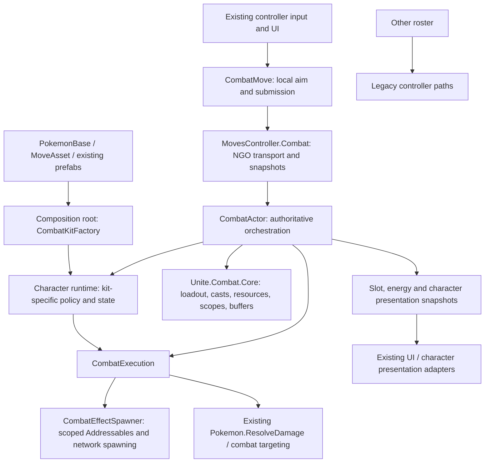
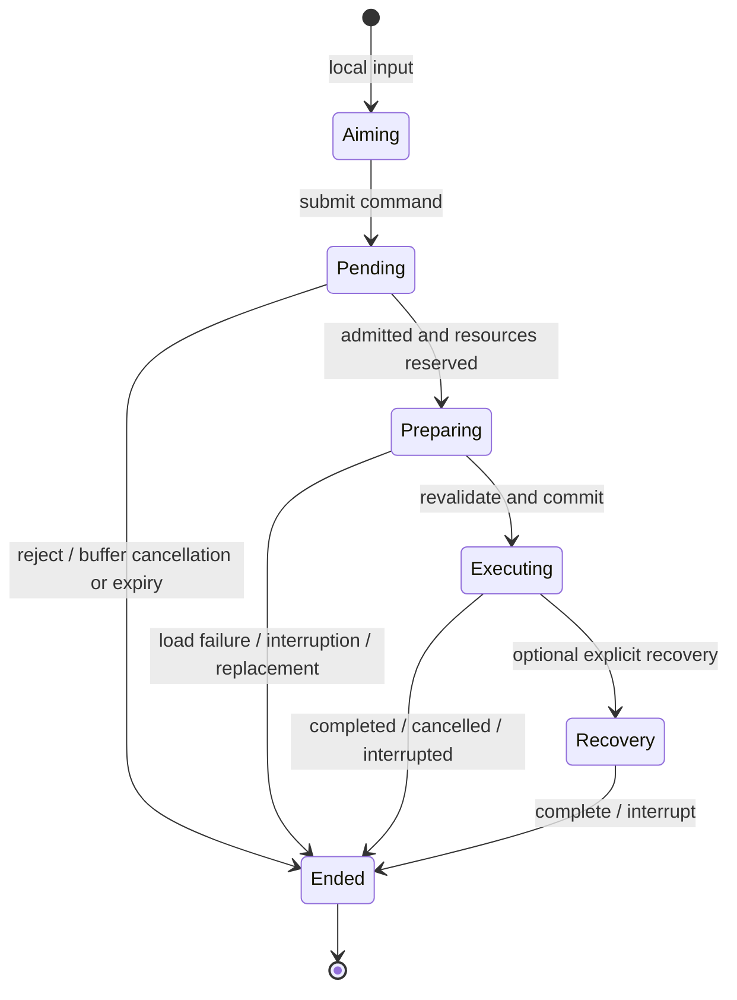

# Combat architecture: staged roster migration

## Rollout boundary

Glaceon, Zoroark, Cinderace, Sylveon and Cresselia opt into the new actor runtime.
`CombatKitFactory` is the composition root: it chooses a character runtime from
the authored passive ID (`GlaceonPassive`, `ZoroarkPassive`, `CinderPassive`,
`SylveonPassive`, `CresseliaPassive`).
Other characters retain their existing move, passive, cooldown, spawning and RPC
paths. Marshadow's copied Glacial Stage and copied Blazing Bicycle Kick (`ShadowBlazingBicycleKick`)
remain their separate legacy mechanics.

Broad phase-two migration and legacy removal remain gated. The reviewed rollout
now includes Cinderace and the parallel Argon Sylveon/Cresselia migrations while
keeping legacy controller infrastructure intact for all nonmigrated kits. All participants must use the same build; the added
network variables change the shared controller's network schema.

## Ownership and dependency direction



`Unite.Combat.Core` has no Unity references. It does not know character classes,
controllers, prefabs, NGO, damage formulas, input devices or UI. Shared actor
orchestration depends on generic character hooks, not named-character branches.
Concrete character selection and asset contracts belong in the composition root.
The remaining named controller partials are compatibility/transport surfaces,
not owners of migrated character state.

Presentation is still hosted partly by the character runtime and old UI adapters.
This is a transitional Unity-layer boundary, not a fully separate presenter layer.

## Three distinct identities

| Type | Lifetime | Responsibility |
| --- | --- | --- |
| `AbilityDefinition` | Definition | Immutable resource/cooldown configuration |
| `AbilityInstance` | Equipped slot revision | Upgrade state and resource ownership |
| `CastSession` | One attempted execution | Correlation, reservation, outcome and cleanup |

Installing a different ability advances the slot revision and ends old casts.
The replacement inherits the slot's remaining cooldown after cast cleanup,
including cooldowns that start on effect end and pending stored-use recovery.
Upgrading the same ability preserves the equipped instance and its resources.
Replacing one slot does not reset unrelated slots. Request IDs identify owner
commands; cast IDs identify server-created executions. They are not interchangeable.

## Authoritative cast flow

```mermaid
sequenceDiagram
    participant Owner as Owner input / CombatMove
    participant Server as CombatActor
    participant Core as CastCoordinator / resources
    participant Execution as Character execution
    participant Clients as Presentation replicas
    Owner->>Owner: Aim locally
    Owner->>Server: Request ID, slot/revision, move ID, direction/target
    Server->>Server: Admit request once; validate actor and learned slot
    alt Temporarily action-locked
        Server->>Server: Buffer briefly; duplicates stay pending
    end
    Server->>Core: Reserve resources; create Preparing session
    Server->>Execution: Prepare scoped assets asynchronously
    Execution-->>Server: Prepared
    Server->>Server: Revalidate actor, action locks, target, kit policy and energy
    alt Valid
        Server->>Core: Commit reservation exactly once
        Server-->>Owner: Accepted result
        Server->>Execution: Commit kit policy; start server execution
        Server-->>Clients: Authoritative slot/energy/character state
        Execution-->>Server: Complete / interrupt / cancel
        Server->>Core: End session and dispose scope
    else Invalid or cancelled
        Server->>Core: End without committing reserved resources
        Server-->>Owner: Rejected result; clear pending local input
    end
```

Preparation has an eight-second deadline. The actor invalidates preparations on
interrupting status additions, death, slot replacement or despawn; final action
eligibility is checked again after loading. A cast cannot spend resources just
because validation passed before an asynchronous load.

Admission order is separate from execution order: buffered commands may drain
out of arrival order without being mistaken for replays. Queued duplicates and
queries remain pending; completed requests replay their terminal result. Receipt
and completed-session histories are bounded, while high-water marks prevent
evicted commands from executing again.

## Lifecycle and cleanup



Only `Preparing`, `Executing`, `Recovery` and `Ended` are core session phases.
Aiming and pending acceptance are input-layer states. Recast readiness is a
capability of the current execution, not another independent cast-state boolean.
The existing Zoroark effect still owns its internal combo phases; this migration
does not replace all of that effect's booleans with a new combo state machine.

Scopes dispose idempotently in reverse order and continue cleanup if one disposer
throws. The outer session scope stops execution before disposing its inner
resource scope, keeping prepared assets available during execution teardown.
Spawn leases, event subscriptions, coroutines and action restrictions belong to
an explicit cast or character lifetime. Deferred cooldowns begin when the
committed execution ends, not when input aiming finishes.

## Unite cast success and interruption refunds

Acceptance/spending and gameplay success are separate milestones. The Unity-free
`UniteCastRefund` captures the spent energy cost and settles once: an interrupted,
cancelled, or execution-failed cast before success restores charge to a minimum
of 90% of that cost, not an additional 90%. Charge earned since casting is kept
if it already exceeds that minimum. The actor clamps to its current capacity and
replicates the corrected charge through the existing Unite snapshot/HUD path.

Rejected/preparation-failed casts in `CombatActor` spend no energy and keep 100%.
Normal completion, replacement, and actor despawn do not award a refund. Replayed
requests and repeated cleanup cannot issue a second refund.

`PrefabMove.UsesExplicitUniteCastCheckpoint` defaults to false: ordinary moves
become successful when their execution starts. A Unite with an interruptible
startup overrides it to true and calls `CombatExecutionContext.MarkCastSucceeded()`
at its first effective gameplay phase. Prefab executions forward the server-only
`PrefabMoveEffect.Succeeded` signal, emitted by its protected `MarkCastSucceeded()`.
The checkpoint is independent of targets or landed hits; missing enemies is not
a failed cast. No character policy belongs in shared orchestration.

- Zoroark Nightfall Daze: success at the first damaging aura pulse, after the
  initial one-third-second windup. Death before it refunds 72,000 / 80,000;
  death after it does not refund, even if the pulse hit nobody.
- Absol Midnight Slash: success when its windup animation ends and the flurry
  starts. It uses the same tracker through the legacy prefab compatibility path.
  Server-authorized, sequence-correlated owner delivery updates the legacy HUD;
  application is deferred one frame so host input completion cannot overwrite it.
- Other existing Unite startup semantics remain unchanged until their definitions
  opt into a more specific checkpoint. Older non-prefab legacy moves are unchanged.

## Character integrations

### Zoroark

- `ZoroarkCharacterRuntime` owns Night Slash/Feint Attack references, aerial
  capability policy, Illusion, replicated presentation and cleanup.
- `ZoroarkExecution` owns seven named move routines, dash/finisher phases and
  cast-local combo state. Its `Execute()` is dispatch-only.
- `ZoroarkMoveEffect` retains its serialized identity as a thin network,
  traversal and presentation adapter bound to one execution. Its only execution
  coroutine delegates to that owner's lifecycle; it no longer implements the kit.
- Aerial reposition preparation does not consume the aerial opportunity.
  Revalidation checks the original execution/window; commitment consumes once.
- Shared spawning and basic-attack eligibility no longer inspect concrete
  Zoroark effect types. Existing controller RPC signatures remain compatible.
- Segmented gauge presentation resolves the authored Resources prefab and then
  obtains its module component.

### Glaceon

- Thin `CombatMove` classes retain identity, aiming metadata and authored balance.
- `GlaceonCharacterRuntime` owns crystals, expiry, attack charge/modes and passive
  presentation. `GlaceonExecution` owns server ability execution and cleanup.
- Basic attacks, homing shots, Freeze Dry, Spear and Glacial Stage resolve gameplay
  on the server using existing damage and status systems.
- Spear starts consuming crystals on press. Release stops the hitbox and its
  restrictions without ending the consumption window; re-press resumes the same
  execution for free. Cooldown begins when crystals run out or the execution is
  explicitly cancelled/interrupted, not on ordinary button release.
- Freeze Dry ignores allied overlaps instead of aborting the entire explosion;
  explosions and targets are deduplicated.
- Passive crystals use revisioned snapshots rather than uncorrelated spawn
  callbacks and presentation increment/decrement messages.

The migration baseline is executable behavior rather than move-description text.
No missing Snow Cloak mechanic, Tail Whip debuffs, Icy Wind upgrade mechanic or
Glacial Stage leap is added. Target deduplication and authoritative validation
are intentional reliability changes. Swift's old attempt-event behavior when
there is no valid target needs explicit gameplay acceptance: the new server
attack path requires a valid target rather than trusting an owner-side attempt.

### Cinderace (Phase 2.1)

- `CinderMoveBase` and all seven move definitions (`CinderEmber`, `CinderLowSweep`,
  `CinderPyroball`, `CinderBlazeKick`, `CinderFlameCharge`, `CinderFeint`,
  `BlazingBycicleKick`) are thin `CombatMove` input/aim bridges with `PrefabPath => null`
  and `CooldownOnFinish => false`. Authored move IDs, cooldowns, ranges and
  learnset progression (0/2, 6, 7, 8, 10, 12 across Scorbunny, Raboot and
  Cinderace) are preserved unchanged.
- `CinderBasicAtk` is a server-resolved `ChargedBasicAttackBase` (`ServerResolved => true`)
  that requests server basic attacks and renders `BoostedAttackCounterModule` from
  authoritative snapshots without local charge invention.
- `CinderaceCharacterRuntime` owns all authoritative Cinderace state and lifecycle:
  boosted attack charge (`0..2`), Feint+ healing attack count (`3`), Flame Charge+
  armed slow flag, Blaze passive cooldown/trigger (`<= 50%` HP every 30s, `+10`
  CritRate and `+20` AtkSpeed for 5s), per-target Cinders mark stacks (`1..5`, 5s
  expiry, 5th stack Flare detonation capped at 500 vs wilds), Burn periodic DOT
  (`StatusEffect.DamageOverTime`) and Attack/SpAttack debuffs, movement lock
  leases, dash/kick traversal replication (`CinderaceDashRPC`), Blaze Kick rebound
  movement input (`CinderaceMovementRPC`), and revisioned presentation snapshots
  (`CinderaceSnapshotRPC` and `combatCharacterState` JSON).
- `CinderaceExecution` prepares and spawns the eleven `CinderMoveObject` prefabs
  through `CombatEffectSpawner`, owns `CombatActionLock` and movement lock leases
  in `Context.Scope`, rejects `LowSweep` and `FlameCharge` while `Immobilized`
  during both `PrepareCast` and `RevalidateCast` without spending cooldown, fills
  boosted attack charge (`charge = 2`) on `CommitCast`, and drives dash/kick/recovery
  timings (`LowSweep`/`FlameCharge` 0.2s, `BlazeKick` 0.25s approach + 0.25s
  rebound, `Ember` 0.4s, `PyroBall` 1.1s, `Feint` 0.73s, `Unite` 1.0s) before
  recovering animation to `"ani_idle_bat_0815"` across all three evolution models.
- Upgraded `PyroBall` reduces Slot B cooldown by 4s through `CombatActor.ReduceCooldown(1, 4d)`
  and immediately clears the HUD timer when the remaining cooldown reaches zero.
- `MovesController.Cinderace.cs` remains a stateless compatibility/transport
  facade forwarding to `CinderaceCharacterRuntime`; legacy `UpdateCinderaceRuntime`
  and `DisposeCinderaceRuntime` hooks are removed so no double ticking occurs.
- Cinderace uses shared Unity-layer `CombatRoutine` and `CombatCallbackLease`
  lifecycle primitives, not Glaceon-specific implementation helpers. Glaceon also
  uses `CombatRoutine`; its coroutine disposal behavior is unchanged.
- Each spawned `CinderMoveObject` retains an independent Addressables reference
  until destruction. Projectiles can outlive cast recovery without losing their
  assets or being despawned by successful cast cleanup. Interrupted casts still
  despawn their active effect. Only actor-lifetime loads populate the prefab cache;
  short-lived mark visual scopes cannot leave dangling cached references.

### Sylveon and Cresselia (parallel Argon rollout)

- `SylveonCharacterRuntime` owns basic charge, passive stacks, traversal and channel presentation; `SylveonExecution` owns cast lifecycles. Existing handwritten effects retain their mechanics and independent asset leases through instance destruction. Fairy Frolic releases cast restrictions on landing while its healing buff continues.
- `CresseliaCharacterRuntime` owns boost readiness, escort, support effects and replicated flight state; `CresseliaExecution` owns cast recovery and the Unite follow-up session. Lasting shields/fields/projectiles use separate tracked scopes rather than dying at cast recovery.
- Optional ally targeting is an explicit generic move contract, not a mutable per-slot target RPC. An admitted request retains its own target through buffering, and explicit invalid targets reject rather than becoming self-casts.
- Composition and validation derive migration membership from `CombatKitFactory.SupportsDefinition`. Cosmetic-only asset contracts explicitly opt out of network-prefab requirements without kit-specific validator exceptions.
- The parent removed temporary reflection-based runtime injection, obsolete Cresselia direct-cast/Unite transport and duplicate input/tick hooks. No character policy was introduced into `Unite.Combat.Core`.
- See `Docs/CombatMigrations/Sylveon.md` and `Docs/CombatMigrations/Cresselia.md` for per-kit behavior and remote-owner acceptance checks.

### Vaporeon, Jolteon and Flareon (parallel Terra rollout)

- Each kit has a direct `CombatCharacterRuntime`/`CombatExecution` pair and seven
  named move coroutines selected by a dispatch-only `Execute()`. Move/basic/passive
  bridges no longer execute a parallel legacy timeline. The composition root
  explicitly opts in the three passives without adding named-character policy to
  shared orchestration or the Unity-free core.
- Vaporeon owns independent support/field scopes, Dive emergence and deferred
  cooldown, Hydration, basic charge and revisioned active visual bindings. Its
  Unite checkpoint is impact after windup, making earlier interruptions eligible
  for the shared one-shot 90% refund.
- Jolteon owns passive meter, independently leased Swift children and Web marks,
  execution-local dash recasts and validated Unite steering. Its success
  checkpoint follows a successfully spawned rush effect. Basic recovery checks
  the controller's spawn state before sending teardown RPCs and is cancelled on
  death, preventing an unspawned RPC during disposal.
- Flareon owns passive/basic state, independent Swift/Heat Wave fields, traversal
  and a target-correlated Takedown/Slam execution. The slot snapshot carries the
  follow-up target alongside readiness and cast ID, avoiding an ordering race
  against the separately arriving character snapshot. Unite succeeds on landing
  immediately before damage.
- Busy-only recovery input buffering is a generic runtime policy. A release
  updates the retained press without extending its expiry, and draining waits
  until the slot is usable. Death, interruption and revision changes invalidate
  pending input; cooldown/disabled actions are not silently buffered.
- The legacy client-authored projectile/spawn/despawn RPCs reject migrated actors
  while remaining available to unmigrated kits. Vaporeon's required prefabs are
  cosmetic-only; Jolteon and Flareon effects remain networked. Flareon asset
  validation excludes `Basic`, which has no separate effect prefab.
- See `Docs/CombatMigrations/Vaporeon.md`, `Docs/CombatMigrations/Jolteon.md` and
  `Docs/CombatMigrations/Flareon.md` for state/lifetime and manual acceptance maps.

## Replication and compatibility limits

The server writes slot snapshots (identity/revision, charges, cooldown deadline,
reservation, deferred cooldown and follow-up capability), Unite energy and a
bounded character-owned presentation snapshot. Most kits use JSON; Vaporeon
uses a Deflate-compressed binary payload encoded as Base64. Migrated kits
additionally send immediate revisioned transitions; stale snapshots cannot undo
newer transitions. Snapshots reconstruct presentation for observers; they do not
serialize an execution's private coroutine state for client-side gameplay simulation.

Unite energy capacity is resolved from the authored learnset when the actor
runtime is created, independently of learning the Unite move. Passive, score and
kill grants can accumulate from the start of gameplay; learning the move does
not reset that energy. Starting an accepted Feint Attack resets slot A's cooldown;
subsequent hit-confirmed Feint returns retain their existing reset behavior.

Movement remains integrated with the existing player movement/network-transform
system. Server authorization does not mean every movement path has been replaced
with a new rollback/prediction stack. Real remote-owner dash and flight behavior
must be verified in multiplayer.

Legacy generic damage/spawn RPCs remain for unmigrated characters. The migrated
honest-client path is server-owned, but this phase does not constitute complete
network security hardening of the entire game.

## Asset contracts

Run **Tools > Combat > Validate Phase One** before testing or building. The same
validation runs before builds and in migration contract tests. It checks migrated
learnsets/factories (Zoroark, Glaceon, Cinderace, Sylveon, Cresselia, Vaporeon,
Jolteon and Flareon), required prefab components,
Addressables registration, network prefab registration and the segmented-gauge
Resources contract. Existing move IDs, GUIDs, prefab paths and the
`GlaceIcycleSpear` / `BlazingBycicleKick` enum spellings are retained.

## Extending the architecture after phase-one acceptance

Follow `Docs/CombatMigrations/README.md` for the required file layout, per-move
coroutine structure, runtime organization and review checklist. Sylveon is the
canonical reference, not the earlier Cinderace/Glaceon/Cresselia layouts or the
old Zoroark effect-based executor.

1. Map implemented gameplay behavior, resource ownership and prefab contracts.
2. Implement local `CombatMove` definitions and the primary
   `<Character>CharacterRuntime` / `<Character>Execution` pair under
   `Assets/Scripts/Combat/Characters`. Runtime owns shared kit state; execution
   has one clearly named coroutine for every move, including initial moves.
3. Keep `Execute()` dispatch-only. Use shared targeting/damage, prefab helpers and
   scoped leases. Never accept caller-authored damage or asset paths in the new
   cast protocol.
4. Add the kit at the composition root, not in shared orchestration branches.
5. Add core tests for new generic rules, asset-contract tests, and real NGO
   host/dedicated-server execution tests. Verify a remote owner separately.
6. Once the whole roster has migrated and passed acceptance, remove the legacy
   controller paths and compatibility adapters in phase two.

### Normalized implementation layout

All eight migrated kits use the primary runtime/execution pair and seven named
move coroutines. Cinderace's basic attacks, Blaze/Cinders passive, Feint healing,
Flame Charge slow, traversal, assets and presentation are grouped by responsibility;
Glaceon and Cresselia no longer implement all moves inside a single selector.
Zoroark's timelines and combo state live in `ZoroarkExecution`, not its serialized
prefab adapter. Sylveon remains the reference pattern.

`CombatCharacterStructureTests` guards the primary pair, named move entry points,
dispatch-only selector and absence of Zoroark timelines in the network adapter.
These tests complement gameplay tests; they do not replace a review of state
ownership or independently prove that helpers implement the correct behavior.

The per-character notes in `Docs/CombatMigrations` map move entry points,
persistent state, independent effect lifetimes and compatibility boundaries.

## Earlier five-kit validation (November 1, 2026)

Unity editor compilation succeeds on `6000.3.24f1`. Asset contracts pass for all
five migrated kits, including Cresselia's cosmetic-only Addressables.
`git diff --check` passes. Editor Play Mode options are restored after validation;
validation does not change unrelated persistent editor preferences.

| Mode | Selected regression assemblies | Passed | Failed | Total |
| --- | --- | ---: | ---: | ---: |
| EditMode | Core, Migration, Zoroark, Absol, Cinderace, Cresselia, Sylveon, HPBar, Flareon, Marshadow, Moves, Ninetales | 647 | 4 | 651 |
| PlayMode | Zoroark, Absol, HPBar, Cresselia, Sylveon, Ninetales | 222 | 0 | 222 |

Unite refunds add 17 Unity-free policy cases, six definition contracts, and seven
server/host PlayMode cases. Coverage includes early versus post-checkpoint death
with no targets, replicated owner charge/cooldown state, pre-spend rejection,
and duplicate request/refund delivery. All new cases pass.

Sylveon movement regressions are covered by independent pending movement-policy
contracts and server/host execution tests for Swift, Hyper Voice and Fairy Frolic.
The owner-submission test also checks buffered acceptance, preserved action locks,
and unrelated movement restrictions without introducing a transient movement stop.

Normalization adds 19 EditMode cases: 11 cross-kit structural guards, seven
Glaceon move-entry contracts and one Zoroark execution contract. These all pass.
Review also completed the actual Zoroark state/timeline extraction rather than
accepting an intermediate wrapper over the original effect executor. Cresselia's
zero-windup support moves retain immediate execution without yielding an empty
startup coroutine; existing buffered-target and cleanse tests guard that timing.
Zoroark combo reflection tests now inspect their execution owner without changing
their damage, step, timing or cleanup assertions.
After correcting those integration issues, the full selected PlayMode set passes
222/222. Compilation, authored asset contracts and whitespace checks pass, and
Editor Play Mode options are restored to `None` both in memory and on disk.

The EditMode failures are pre-existing assertions, not normalization regressions:

- `MoveUseTests.PrefabsHaveWiredReserveUiWithoutItsDuplicatedIcon` fails for the
  unchanged `MoveUI.prefab` and `MoveUIMobile.prefab` at `MoveUseTests.cs:171`.
- `CresseliaTests.LearnsetAndRangedMetadataMatchTheKit` dereferences a missing
  serialized `description` member at `CresseliaTests.cs:160`. The assertion already
  existed, and `PokemonBase` has no such field. This unrelated metadata contract
  remains unchanged rather than being weakened to make the suite green.
- The newly included Absol suite has a stale assertion at `AbsolTests.cs:165`
  expecting `SylvCalmMind.CooldownOnFinish` to remain true, although Sylveon's
  earlier migration made it a `CombatMove` with server-owned cooldowns.

The PlayMode set includes 45 Sylveon/Cresselia server/host cases, the previous
87 migrated-kit/HPBar cases, and 34 Ninetales regressions. Tests cover pre-learning
Unite energy, idempotent cleanup, persistent effect/asset ownership, per-kit
mechanics, animation recovery on hosts, support targeting and buffering,
immobilized dash rejection versus stationary casts, and compatibility gauges.
All new migration tests pass; the full selected EditMode run is not wholly green
because of the four baseline failures above.

The parallel Argon implementations required parent integration corrections:
normal composition-root runtime construction instead of reflected readonly-field
injection, request-correlated optional ally targets instead of mutable per-slot
RPC state, removal of duplicate controller hooks and old direct-cast transport,
Sylveon despawn-safe Fairy Frolic cleanup, stationary-cast root handling, and test
fixtures using actual project enums/levels/APIs. Sylveon's passive adapter no
longer retains a second set of gameplay timers or event subscriptions. Its tracked
Swift projectile set is pruned to avoid retaining destroyed instances indefinitely.

The original Cinderace experiment also required parent review fixes for successful
cast cleanup destroying in-flight projectiles, premature asset release, and
cross-character lifecycle-helper dependencies. These results support reviewed
parallel migrations, not unattended acceptance based on an agent summary.

These fixtures exercise real NGO hosts and dedicated servers, but do not attach
a remote owning client. They are not a substitute for the multiplayer acceptance
gate below or a complete balance-parity certification of every move. Revisioned
character snapshots restore state/gauges/flight presentation; Cresselia's local
cosmetic effect cues are not a replay log of every already-running field for a
late joiner.

## Three-kit integration validation (November 1, 2026)

Vaporeon, Jolteon and Flareon are registered and integrated, not unregistered
prototypes. The final combined run uses live Unity `6000.3.24f1` after all three
parallel agents completed. Compilation and `CombatArchitectureValidator` pass
with no asset errors. `git diff --check` and the asset metadata GUID uniqueness
check pass. Play Mode options are restored to `None` in memory and `0` on disk;
no generated `InitTestScene` files remain after the run.

| Mode | Selected regression assemblies | Passed | Failed | Skipped | Total |
| --- | --- | ---: | ---: | ---: | ---: |
| EditMode | Core, Migration, Zoroark, Absol, Cinderace, Cresselia, Sylveon, HPBar, Flareon, Marshadow, Moves, Ninetales, Vaporeon, Jolteon | 795 | 5 | 0 | 800 |
| PlayMode | Zoroark, Absol, HPBar, Cresselia, Sylveon, Ninetales, Vaporeon, Jolteon, Flareon | 310 | 0 | 1 | 311 |

Assembly names use `Unite.<Name>.Tests` for EditMode, except
`Unite.Combat.Core.Tests` and `Unite.Combat.Migration.Tests`; PlayMode assemblies
use `Unite.<Name>.PlayMode.Tests`. The selected PlayMode set includes all 89
three-kit cases: 88 pass and one dedicated-server instance of the host-only
Vaporeon owner-input test is intentionally skipped. Its host counterpart passes.
All 222 previously selected PlayMode cases continue to pass.

The five EditMode failures are unchanged assertions, not migration regressions:

- The four earlier baseline failures remain: Absol's stale Sylveon cooldown
  expectation, Cresselia's missing serialized `description` assertion, and the
  two reserve-UI prefab assertions documented in the earlier run.
- The newly included Vaporeon suite exposes the same missing-description
  assertion at `VaporeonTests.cs:86`. This assertion also exists at HEAD, while
  `PokemonBase` has no serialized `description` member. Its learnset, upgrades
  and passive assertions preceding that dereference pass. The unrelated
  metadata assertion was not weakened or removed.

Parent validation corrected an ambiguous `CompressionLevel` reference, reflected
constructor overload selection in fixtures, lobby bootstrap and teardown setup
for NGO observers, and Jolteon's unspawned basic-recovery RPC. Tests now feed the
actual runtime/basic snapshots instead of removed legacy controller fields and
inspect traversal ownership/policy in executions while retaining physical-wall
and landing assertions. The Charge/Web test uses distinct legal loadouts rather
than attempting a forbidden same-tier replacement. The Flareon passive fixture
supplies an actually burned target instead of assuming Heat Wave applies burn.

Coverage includes early and post-checkpoint Unite death, one-shot 90% refunds,
pre-learning energy across all eight kits, independent effect lifetimes,
recasts, target validation, cooldown/HUD metadata, basics/passives, revision
ordering, recovery input release/expiry, death/despawn cleanup and compatibility
with the earlier kits. Jolteon's fixtures also attach an in-process remote client
and late observer for correction and mark-state checks. These are automated
fixtures, not real remote-owner latency, loss or gameplay-feel acceptance.

Vaporeon's snapshot fallback fits its tested team-sized stress case but is not
a formal bound for arbitrarily many persistent visual targets. The existing
owner-authoritative movement stack likewise remains a limitation; server cast
validation and position corrections are not complete transform security or a
new prediction/rollback system. The manual gates below remain required.

## Manual acceptance gate

- Run a host with a remote owning client, then a dedicated server with two clients.
- Check all four Glaceon loadouts, levels 3/5/7 and upgrades 9/11, both target
  priorities, no-target attack attempts, attack counter and crystal expiry.
- Hold/release/re-press Spear without starting a new cooldown or granting fresh
  crystals. Leave it released until crystals run out, then verify cooldown begins.
  Interrupt it, die, replace its move and despawn while holding; confirm all
  restrictions recover exactly once.
- Test simultaneous casts while Addressables are cold; cancel during loading and
  verify no stale spawn, cooldown spend, inherited lock or wrong callback target.
- Test Freeze Dry with allies and multiple colliders around enemies; check hit
  count, crystal rewards and authored damage/buffs.
- Verify Icy Wind dash and crystal restore, Ice Shard expiry, Unite flight/zone
  and crystal generation on a remote owner under latency.
- Verify Zoroark combo recasts, aerial spending, basic-attack gates, interruption,
  Illusion breaks and gauges; reconnect/late-observe during active effects.
- Verify Cinderace across Scorbunny/Raboot/Cinderace stages (levels 1/5/7/9/11/13),
  Ember/Low Sweep, Pyro Ball/Blaze Kick, Flame Charge/Feint, Blazing Bicycle Kick,
  immobilized dash rejection, Blaze Kick directional rebound, Pyro Ball+ Slot B
  cooldown reduction, Flame Charge+ boosted basic slow, Feint+ 3 healing basics,
  passive Blaze trigger and 5-stack Cinders/Flare detonation on a remote owner.
- Verify all Sylveon branches, Eevee/Sylveon basic animations, Hyper Voice facing,
  gauge and interruptions, Mystical Fire dash/cooldown HUD, max-range Swift/Eyes,
  and Fairy Frolic landing/unlocked buff window on a remote owner.
- Verify Cresselia ally cone/self-cast behavior, shield-expiry healing, Moonlight
  pulses, boost/escort gauge and halo, and Unite takeoff/free flight/recast/landing
  with one energy spend on a remote owner. Check late-observed flight timers and
  document cosmetic-only effects that do not replay for late joiners.
- Verify Vaporeon's remote-owner Rain hop, wall-valid Dive exit/recast, cooldown
  on interrupted emergence, recovery-buffer expiry, support target bindings and
  late-observed field visuals. Stress cold Addressables and the bounded snapshot
  transport with the supported actor count.
- Verify Jolteon's remote-owner dash/Unite steering under latency and packet loss,
  final wall-valid positions, earned recast HUD, basic idle recovery and late Web
  marks. Check both pre-checkpoint refund and post-checkpoint interruption.
- Verify Flareon's remote-owner traversal, target-correlated Slam HUD/recast,
  independent field replacement and cleanup, boosted basic/passive counters and
  Unite landing/refund under latency. Owner transform corrections are not a new
  rollback/prediction or fully server-authoritative movement stack.
- Smoke-test legacy characters, Marshadow copied Unite, cooldown reduction,
  scoring/kill Unite charge and bot loadouts before approving broader phase-two
  migrations.
