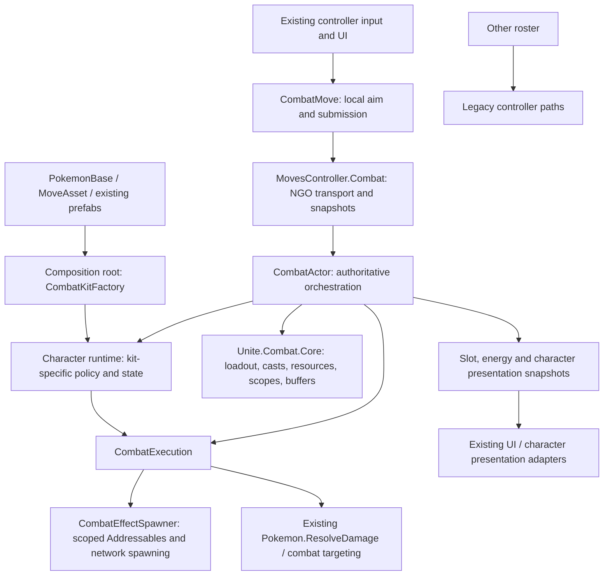
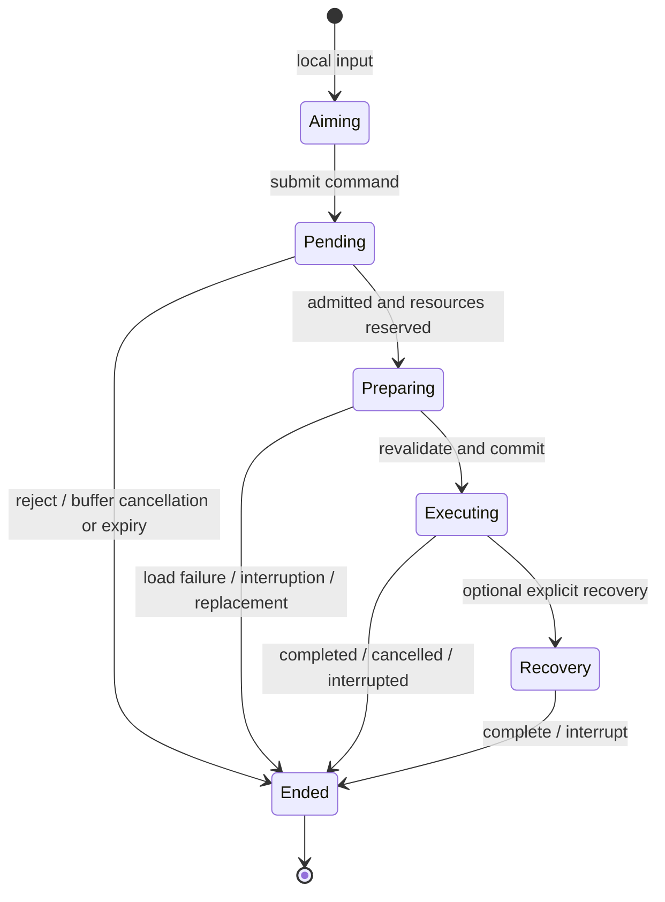

# Combat architecture: phase one and phase 2.1 (Cinderace)

## Rollout boundary

Glaceon, Zoroark and (in Phase 2.1) Cinderace opt into the new actor runtime.
`CombatKitFactory` is the composition root: it chooses a character runtime from
the authored passive ID (`GlaceonPassive`, `ZoroarkPassive`, `CinderPassive`).
Other characters retain their existing move, passive, cooldown, spawning and RPC
paths. Marshadow's copied Glacial Stage and copied Blazing Bicycle Kick (`ShadowBlazingBicycleKick`)
remain their separate legacy mechanics.

Broad phase-two migration and legacy removal remain gated. Only Cinderace is
opted in for Phase 2.1 while keeping legacy controller infrastructure intact for
all nonmigrated kits. All participants must use the same build; the added
network variables change the shared controller's network schema.

## Ownership and dependency direction



`Unite.Combat.Core` has no Unity references. It does not know character classes,
controllers, prefabs, NGO, damage formulas, input devices or UI. Shared actor
orchestration depends on generic character hooks, not named-character branches.
Concrete character selection and asset contracts belong in the composition root.
The remaining named controller partials are compatibility/transport surfaces,
not owners of migrated character state.

Presentation is still hosted partly by the character runtime and old UI adapters.
This is a transitional Unity-layer boundary, not a fully separate presenter layer.

## Three distinct identities

| Type | Lifetime | Responsibility |
| --- | --- | --- |
| `AbilityDefinition` | Definition | Immutable resource/cooldown configuration |
| `AbilityInstance` | Equipped slot revision | Upgrade state and resource ownership |
| `CastSession` | One attempted execution | Correlation, reservation, outcome and cleanup |

Installing a different ability advances the slot revision and ends old casts.
Upgrading the same ability preserves the equipped instance and its resources.
Replacing one slot does not reset unrelated slots. Request IDs identify owner
commands; cast IDs identify server-created executions. They are not interchangeable.

## Authoritative cast flow

```mermaid
sequenceDiagram
    participant Owner as Owner input / CombatMove
    participant Server as CombatActor
    participant Core as CastCoordinator / resources
    participant Execution as Character execution
    participant Clients as Presentation replicas
    Owner->>Owner: Aim locally
    Owner->>Server: Request ID, slot/revision, move ID, direction/target
    Server->>Server: Admit request once; validate actor and learned slot
    alt Temporarily action-locked
        Server->>Server: Buffer briefly; duplicates stay pending
    end
    Server->>Core: Reserve resources; create Preparing session
    Server->>Execution: Prepare scoped assets asynchronously
    Execution-->>Server: Prepared
    Server->>Server: Revalidate actor, action locks, target, kit policy and energy
    alt Valid
        Server->>Core: Commit reservation exactly once
        Server-->>Owner: Accepted result
        Server->>Execution: Commit kit policy; start server execution
        Server-->>Clients: Authoritative slot/energy/character state
        Execution-->>Server: Complete / interrupt / cancel
        Server->>Core: End session and dispose scope
    else Invalid or cancelled
        Server->>Core: End without committing reserved resources
        Server-->>Owner: Rejected result; clear pending local input
    end
```

Preparation has an eight-second deadline. The actor invalidates preparations on
interrupting status additions, death, slot replacement or despawn; final action
eligibility is checked again after loading. A cast cannot spend resources just
because validation passed before an asynchronous load.

Admission order is separate from execution order: buffered commands may drain
out of arrival order without being mistaken for replays. Queued duplicates and
queries remain pending; completed requests replay their terminal result. Receipt
and completed-session histories are bounded, while high-water marks prevent
evicted commands from executing again.

## Lifecycle and cleanup



Only `Preparing`, `Executing`, `Recovery` and `Ended` are core session phases.
Aiming and pending acceptance are input-layer states. Recast readiness is a
capability of the current execution, not another independent cast-state boolean.
The existing Zoroark effect still owns its internal combo phases; this migration
does not replace all of that effect's booleans with a new combo state machine.

Scopes dispose idempotently in reverse order and continue cleanup if one disposer
throws. The outer session scope stops execution before disposing its inner
resource scope, keeping prepared assets available during execution teardown.
Spawn leases, event subscriptions, coroutines and action restrictions belong to
an explicit cast or character lifetime. Deferred cooldowns begin when the
committed execution ends, not when input aiming finishes.

## Character integrations

### Zoroark

- `ZoroarkCharacterRuntime` owns Night Slash/Feint Attack references, aerial
  capability policy, Illusion, replicated presentation and cleanup.
- `PrefabCombatExecution` adapts existing `PrefabMoveEffect` behavior to cast
  sessions; effects remain handwritten.
- Aerial reposition preparation does not consume the aerial opportunity.
  Revalidation checks the original effect/window; commitment consumes once.
- Shared spawning and basic-attack eligibility no longer inspect concrete
  Zoroark effect types. Existing controller RPC signatures remain compatible.
- Segmented gauge presentation resolves the authored Resources prefab and then
  obtains its module component.

### Glaceon

- Thin `CombatMove` classes retain identity, aiming metadata and authored balance.
- `GlaceonCharacterRuntime` owns crystals, expiry, attack charge/modes and passive
  presentation. `GlaceonExecution` owns server ability execution and cleanup.
- Basic attacks, homing shots, Freeze Dry, Spear and Glacial Stage resolve gameplay
  on the server using existing damage and status systems.
- Spear starts consuming crystals on press. Release stops the hitbox and its
  restrictions without ending the consumption window; re-press resumes the same
  execution for free. Cooldown begins when crystals run out or the execution is
  explicitly cancelled/interrupted, not on ordinary button release.
- Freeze Dry ignores allied overlaps instead of aborting the entire explosion;
  explosions and targets are deduplicated.
- Passive crystals use revisioned snapshots rather than uncorrelated spawn
  callbacks and presentation increment/decrement messages.

The migration baseline is executable behavior rather than move-description text.
No missing Snow Cloak mechanic, Tail Whip debuffs, Icy Wind upgrade mechanic or
Glacial Stage leap is added. Target deduplication and authoritative validation
are intentional reliability changes. Swift's old attempt-event behavior when
there is no valid target needs explicit gameplay acceptance: the new server
attack path requires a valid target rather than trusting an owner-side attempt.

### Cinderace (Phase 2.1)

- `CinderMoveBase` and all seven move definitions (`CinderEmber`, `CinderLowSweep`,
  `CinderPyroball`, `CinderBlazeKick`, `CinderFlameCharge`, `CinderFeint`,
  `BlazingBycicleKick`) are thin `CombatMove` input/aim bridges with `PrefabPath => null`
  and `CooldownOnFinish => false`. Authored move IDs, cooldowns, ranges and
  learnset progression (0/2, 6, 7, 8, 10, 12 across Scorbunny, Raboot and
  Cinderace) are preserved unchanged.
- `CinderBasicAtk` is a server-resolved `ChargedBasicAttackBase` (`ServerResolved => true`)
  that requests server basic attacks and renders `BoostedAttackCounterModule` from
  authoritative snapshots without local charge invention.
- `CinderaceCharacterRuntime` owns all authoritative Cinderace state and lifecycle:
  boosted attack charge (`0..2`), Feint+ healing attack count (`3`), Flame Charge+
  armed slow flag, Blaze passive cooldown/trigger (`<= 50%` HP every 30s, `+10`
  CritRate and `+20` AtkSpeed for 5s), per-target Cinders mark stacks (`1..5`, 5s
  expiry, 5th stack Flare detonation capped at 500 vs wilds), Burn periodic DOT
  (`StatusEffect.DamageOverTime`) and Attack/SpAttack debuffs, movement lock
  leases, dash/kick traversal replication (`CinderaceDashRPC`), Blaze Kick rebound
  movement input (`CinderaceMovementRPC`), and revisioned presentation snapshots
  (`CinderaceSnapshotRPC` and `combatCharacterState` JSON).
- `CinderaceExecution` prepares and spawns the eleven `CinderMoveObject` prefabs
  through `CombatEffectSpawner`, owns `CombatActionLock` and movement lock leases
  in `Context.Scope`, rejects `LowSweep` and `FlameCharge` while `Immobilized`
  during both `PrepareCast` and `RevalidateCast` without spending cooldown, fills
  boosted attack charge (`charge = 2`) on `CommitCast`, and drives dash/kick/recovery
  timings (`LowSweep`/`FlameCharge` 0.2s, `BlazeKick` 0.25s approach + 0.25s
  rebound, `Ember` 0.4s, `PyroBall` 1.1s, `Feint` 0.73s, `Unite` 1.0s) before
  recovering animation to `"ani_idle_bat_0815"` across all three evolution models.
- Upgraded `PyroBall` reduces Slot B cooldown by 4s through `CombatActor.ReduceCooldown(1, 4d)`
  and immediately clears the HUD timer when the remaining cooldown reaches zero.
- `MovesController.Cinderace.cs` remains a stateless compatibility/transport
  facade forwarding to `CinderaceCharacterRuntime`; legacy `UpdateCinderaceRuntime`
  and `DisposeCinderaceRuntime` hooks are removed so no double ticking occurs.
- Cinderace uses shared Unity-layer `CombatRoutine` and `CombatCallbackLease`
  lifecycle primitives, not Glaceon-specific implementation helpers. Glaceon also
  uses `CombatRoutine`; its coroutine disposal behavior is unchanged.
- Each spawned `CinderMoveObject` retains an independent Addressables reference
  until destruction. Projectiles can outlive cast recovery without losing their
  assets or being despawned by successful cast cleanup. Interrupted casts still
  despawn their active effect. Only actor-lifetime loads populate the prefab cache;
  short-lived mark visual scopes cannot leave dangling cached references.

## Replication and compatibility limits

The server writes slot snapshots (identity/revision, charges, cooldown deadline,
reservation, deferred cooldown and follow-up capability), Unite energy and a
bounded character-owned JSON presentation snapshot. Glaceon and Cinderace
additionally send immediate revisioned transitions; stale snapshots cannot undo
newer transitions. Snapshots reconstruct presentation for observers; they do not
serialize an execution's private coroutine state for client-side gameplay simulation.

Unite energy capacity is resolved from the authored learnset when the actor
runtime is created, independently of learning the Unite move. Passive, score and
kill grants can accumulate from the start of gameplay; learning the move does
not reset that energy. Starting an accepted Feint Attack resets slot A's cooldown;
subsequent hit-confirmed Feint returns retain their existing reset behavior.

Movement remains integrated with the existing player movement/network-transform
system. Server authorization does not mean every movement path has been replaced
with a new rollback/prediction stack. Real remote-owner dash and flight behavior
must be verified in multiplayer.

Legacy generic damage/spawn RPCs remain for unmigrated characters. The migrated
honest-client path is server-owned, but this phase does not constitute complete
network security hardening of the entire game.

## Asset contracts

Run **Tools > Combat > Validate Phase One** before testing or building. The same
validation runs before builds and in migration contract tests. It checks migrated
learnsets/factories (Zoroark, Glaceon and Cinderace), required prefab components,
Addressables registration, network prefab registration and the segmented-gauge
Resources contract. Existing move IDs, GUIDs, prefab paths and the
`GlaceIcycleSpear` / `BlazingBycicleKick` enum spellings are retained.

## Extending the architecture after phase-one acceptance

1. Map implemented gameplay behavior, resource ownership and prefab contracts.
2. Implement local `CombatMove` definitions and a character runtime only for
   genuinely shared kit state/policies; keep ordinary execution self-contained.
3. Use `CombatExecution` or the prefab adapter, shared targeting/damage, and
   scoped leases. Never accept caller-authored damage or asset paths in the new
   cast protocol.
4. Add the kit at the composition root, not in shared orchestration branches.
5. Add core tests for new generic rules, asset-contract tests, and real NGO
   host/dedicated-server execution tests. Verify a remote owner separately.
6. Once the whole roster has migrated and passed acceptance, remove the legacy
   controller paths and compatibility adapters in phase two.

## Automated validation (November 1, 2026)

- Unity editor compilation succeeds (`6000.3.24f1`). The core assembly, Cinderace
  runtime/execution scripts and test assets have their Unity metadata;
  `git diff --check` passes.
- Phase 2.1 EditMode validation:
  - `Unite.Combat.Core.Tests` + `Unite.Combat.Migration.Tests` + `Unite.Zoroark.Tests`: **150 passed, 0 failed**.
  - `Unite.Cinderace.Tests`: **49 passed, 0 failed**.
  - `Unite.HPBar.Tests` + `Unite.Flareon.Tests` + `Unite.Marshadow.Tests`: **137 passed, 0 failed**.
  - `Unite.Moves.Tests`: **60 passed, 2 failed** (the two pre-existing
    `MoveUseTests.PrefabsHaveWiredReserveUiWithoutItsDuplicatedIcon` failures on
    unchanged `MoveUI.prefab` and `MoveUIMobile.prefab`).
  - Parent review reran all eight assemblies together: **396 passed, 2 failed**
    out of 398, with only those same pre-existing prefab failures.
- Phase 2.1 PlayMode validation:
  - `Unite.Zoroark.PlayMode.Tests` (real NGO server and host fixtures covering
    Zoroark, Glaceon and Cinderace): **72 passed, 0 failed**, including pre-unlock
    Unite energy accumulation and equip preservation across all three migrated
    kits, Cinderace move commit charge fill, 3-attack charge cycling, 5-stack
    Cinders/Flare detonation, immobilized dash rejection without cooldown spend,
    upgraded Pyro Ball Slot B cooldown reduction, Flame Charge+ armed slow,
    Feint+ cleanse/invincibility/healing basics, Blaze Kick approach/rebound,
    Blaze passive trigger, Scorbunny/Raboot/Cinderace basic-attack idle recovery,
    death/interruption cleanup, and long-range Ember/Unite hits after cast recovery
    with independent asset retention through projectile destruction.
  - `Unite.HPBar.PlayMode.Tests`: **15 passed, 0 failed**, including
    `CinderaceBoostedAttackCounterTests` (`7/7`) and `PlayableAttackCounterTests` (`6/6`).
  - Parent review reran both assemblies together: **87 passed, 0 failed**.

The initial Argon implementation needed parent review corrections for successful
cast cleanup destroying still-flying projectiles, premature asset release, and
cross-character lifecycle-helper dependencies. Validation also remains read-only
with respect to unrelated editor Play Mode settings. This experiment supports
reviewed migrations, not unattended acceptance based on an agent's test summary.

These fixtures exercise real NGO hosts and dedicated servers, but do not attach
a remote owning client. They are not a substitute for the multiplayer acceptance
gate below, nor a complete balance-parity certification of every move.

## Manual acceptance gate

- Run a host with a remote owning client, then a dedicated server with two clients.
- Check all four Glaceon loadouts, levels 3/5/7 and upgrades 9/11, both target
  priorities, no-target attack attempts, attack counter and crystal expiry.
- Hold/release/re-press Spear without starting a new cooldown or granting fresh
  crystals. Leave it released until crystals run out, then verify cooldown begins.
  Interrupt it, die, replace its move and despawn while holding; confirm all
  restrictions recover exactly once.
- Test simultaneous casts while Addressables are cold; cancel during loading and
  verify no stale spawn, cooldown spend, inherited lock or wrong callback target.
- Test Freeze Dry with allies and multiple colliders around enemies; check hit
  count, crystal rewards and authored damage/buffs.
- Verify Icy Wind dash and crystal restore, Ice Shard expiry, Unite flight/zone
  and crystal generation on a remote owner under latency.
- Verify Zoroark combo recasts, aerial spending, basic-attack gates, interruption,
  Illusion breaks and gauges; reconnect/late-observe during active effects.
- Verify Cinderace across Scorbunny/Raboot/Cinderace stages (levels 1/5/7/9/11/13),
  Ember/Low Sweep, Pyro Ball/Blaze Kick, Flame Charge/Feint, Blazing Bicycle Kick,
  immobilized dash rejection, Blaze Kick directional rebound, Pyro Ball+ Slot B
  cooldown reduction, Flame Charge+ boosted basic slow, Feint+ 3 healing basics,
  passive Blaze trigger and 5-stack Cinders/Flare detonation on a remote owner.
- Smoke-test legacy characters, Marshadow copied Unite, cooldown reduction,
  scoring/kill Unite charge and bot loadouts before approving broader phase-two
  migrations.
